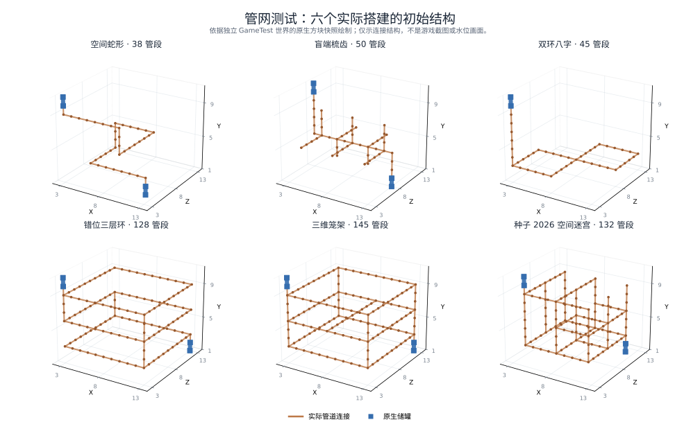

# 微分动力：流体行为覆盖矩阵

当前模型规则见[流体说明](FLUIDS.md)。专项入口为 [VirtualAirIntegrationTests](../src/gameTest/java/com/diliupengyun/differential_create/tests/VirtualAirIntegrationTests.java)，使用 `differentialcreate_air` 命名空间，在 `build/virtual-air/runs/` 中创建独立世界。原生操作用例等待普通服务端 tick，以实际取水、设备交付及逐身份库存判定结果。

## 基础划分

| 范围 | 用例或边界 |
| --- | --- |
| 初始空气与存档 | 新管全空气；当前格式重载；组件、段序、分数余量、容量与轮换游标保存 |
| 空气与泵 | 全空气输送、远端引液、困气、堵口压差及零持续液压功率；无真空、无压缩 |
| 外界与排气 | 封闭空气拒绝世界桶，打开下游后取水；源液体及非源流水浸没不供气；水平无动力口不主动吸液 |
| 距离与容量 | 16、64、256、1024 格线路；水／熔岩各一桶；干泵抬升；999、1000、1001 mB 接收空间 |
| 拓扑与分流 | 三维笼架、编织、梯形、六面出口、盲梳、空间蛇形；改变通路后须有新交付，不要求有限供液的每条支路同时出液 |
| 随机操作 | 24 个固定种子分别注水及熔岩；每网 33 次关口、重开、变速、反向或带液重载 |
| 区块与预算 | 512 格线实际卸载源、中段、接收端或驱动；恢复窗口重新捕获后须新增交付；32 条 128 格网共享预算，每条须新交付 |
| 多种流体 | 水、熔岩、蜂蜜、牛奶、茶、巧克力、药水；同水不同组件单独计账；同格液体／空气队列 |
| 机器与过滤 | 原生储罐、过滤管、阀、盆、注液器、分液池、软管轮、锅炉及蒸汽轴；空气不交给液体能力 |
| 整数接口 | 最后 1 mB 不重复占用；0.4 与 0.6 mB 合并交付；返回与未用源余量结算；独立管网轮流取液；不同身份分数余量保留 |
| 动态供液 | 再生水池、连续或重叠加桶、逐级变速、共用罐腾出临界空间、六桶水／熔岩交替取放 |
| 队列性能 | 5000 次分叉／汇合独立账目；混合闭环长期运行、全空气休眠、连续改连接，见[性能测试](FLUID_PERFORMANCE.md) |



图仅表示连接结构。液体运动、原生接口及守恒由测试执行结果判断。

## 泵方向与无动力边界

[PumpDirectionIntegrationTests](../src/gameTest/java/com/diliupengyun/differential_create/tests/PumpDirectionIntegrationTests.java) 提供 76 项方向场景：36 项六朝向与正反转、12 项流动不能启动静止轴、12 项连续湿态操作、12 项带液读档和 4 项高位顶部取液。

主动增压只由扳手朝向决定。六朝向的正反轴速须向同一接收器实际交付；湿态扳手翻向后向原源罐交付，重载及轴反转后继续沿新朝向输送。外部流动和重力不能启动静止轴，也不能把泵计为动力供给。另检查惰行、重建驱动、堵口、改变泵轴和重复读档的库存与流量连续性。数值回归核对正反轴速等价、净压差、只耗功的阻力矩、液压损耗和强逆流闭环的收敛，不再以守恒等式容许回驱。

[高流量数值回归](../src/physicsTest/java/com/diliupengyun/differential_create/QueuedFluidRateRegression.java) 使用独立的泵压差平衡和无阻力环流判据，覆盖 64–1024 RPM、不同管长、容量和计算步长。原有环流不能因搬运限额自行减速，支路也不能被统一缩放；400 mB/tick 的队列输送须推进完整时间并保持空气与水的独立账目。[原生高流量测试](../src/gameTest/java/com/diliupengyun/differential_create/tests/FluidRateIntegrationTests.java) 则通过真实马达、泵和储罐，验证水与熔岩在连续 60 个普通 tick 中实际交付超过旧限速所允许的量，并逐 tick 核对库存。

[GravityTankIntegrationTests](../src/gameTest/java/com/diliupengyun/differential_create/tests/GravityTankIntegrationTests.java) 提供 6 项无泵三通场景。4 项检查水／熔岩与空／已有液体的低位罐组合；2 项在尚有液柱时用异种世界源封住顶口。后者须保留原液柱，实际取走阻挡源、露出空气后恢复交付，分别核对两种库存。

[FluidMachineIntegrationTests](../src/gameTest/java/com/diliupengyun/differential_create/tests/FluidMachineIntegrationTests.java) 的三项 `forkedFilters*` 场景使用真实混合盆、泵和岔口过滤器，覆盖水先流、熔岩先流和低转速。逐 tick 验证错误身份连小于包体积 ULP 的尾段也不能进入拒收过滤器，并要求两桶流体分别完整到达对应储罐；源罐、管内、原生余量及接收罐的逐液体库存检查保持启用。

[ReservoirBoundaryTests](../src/gameTest/java/com/diliupengyun/differential_create/tests/ReservoirBoundaryTests.java) 检查库存边界：水／熔岩的六面取液（含顶部和高位侧面）、不同液位的无动力水平静止、空竖管先静止后由真实泵引液，以及同一罐高低接口之间先用真实泵充液、再移除泵的重力循环。2 格和 4 格落差须收敛至独立压差平衡给出的流量，逐 tick 核对真实库存。数值回归另覆盖 4／16／64 格落差、不同密度，以及正反向高速惯性流动的耗散和不反向条件。

原生机器和复杂拓扑的供液夹具使用真实马达、泵启动，不能继续依赖已移除的容器压头。专门验证重力的场景使用真实世界口、明确计账的初始管内液体，或真实泵完成充液后断开驱动。未知第三方能力实现仍需独立实测。

## 动态改结构

182 项结构用例从空管流动、液体前沿或已有实际交付的状态执行操作，恢复后要求新增原生交付。

| 划分 | 数量 | 操作与判定 |
| --- | ---: | --- |
| 19 种操作 × 3 状态 × 水／熔岩 | 114 | 关面、拆接、快速拆放、盲支路、接收支路、闭环、三维改道、管型转换、过滤管／阀、泵与驱动改变；关闭时停流，恢复后交付 |
| 两条湿网接合再拆分 | 6 | 同身份、异种流体、同水不同组件及两种接合顺序；两端新增交付，各身份分别计账 |
| 多格罐与接收器 | 10 | 增高、扩宽、破坏主控或成员、替换接收罐；容量和能力变化后继续交付 |
| 原生取液源 | 4 | 自然产生不足 1 mB 余量后关面或移走源；已有库存进入管体，关闭时不再取液 |
| 取水后改世界接口 | 18 | 世界口改接罐／管、封口、关面和重载；已有缓存保留，关面期间新桶不被取走 |
| 含水方块 | 1 | 原桶缓存尚在时加入含水活板门，最终实际交付 2000 mB |
| 排放过程中改口 | 6 | 排出 100–800 mB 后关面、封口或重载再恢复；仅生成原桶对应的源，不重播计数 |
| 远端改结构 | 6 | 64、256、1024 格线的湿连接关闭、三维旁路、重开和重载；水／熔岩都须新交付 |
| 多网同时修改 | 1 | 16 条运行网同时关口、加闭环、变速、重载和开通；逐网守恒与交付 |
| 移动结构 | 2 | 湿管由动力轴承组装、转动、回原角度并拆回；移动 NBT 库存及恢复输送 |
| 裸管自动连接 | 4 | 原生物品放置分支／闭环、扳手去包层、破坏再放；自动形状更新及库存 |
| 机器替换／重载 | 8 | 盆与注液器替换或重载，能力对象改变后继续实际接收 |
| 独立网共享接收容量 | 2 | 两条 500 mB 网共用剩余 501 mB 的罐；第二个世界桶须等实际腾出空间后才能取走 |

源码入口：[结构操作](../src/gameTest/java/com/diliupengyun/differential_create/tests/FluidStructureMutationTests.java)、[身份和边界](../src/gameTest/java/com/diliupengyun/differential_create/tests/FluidStructureBoundaryTests.java)、[距离与多网](../src/gameTest/java/com/diliupengyun/differential_create/tests/FluidStructureScaleTests.java)、[移动结构](../src/gameTest/java/com/diliupengyun/differential_create/tests/FluidStructureMovementTests.java)、[物品放置](../src/gameTest/java/com/diliupengyun/differential_create/tests/FluidStructurePlacementTests.java)、[机器替换](../src/gameTest/java/com/diliupengyun/differential_create/tests/FluidStructureMachineTests.java)。动态补水见 [FluidDynamicIntegrationTests](../src/gameTest/java/com/diliupengyun/differential_create/tests/FluidDynamicIntegrationTests.java)。

## 复现与判定

```powershell
.\gradlew.bat build runGameTestServer runVirtualAirServer
.\gradlew.bat runVirtualAirServer -PvirtualAirSelect=pump_direction_.*
.\gradlew.bat runVirtualAirServer -PvirtualAirSelect=structure_.*
```

`virtualAirSelect` 接受逗号分隔的正则表达式。仅执行子集时，按该次输出报告范围。常规 GameTest 默认使用 `run-gametest/`；可用 `-PregressionRunId=<名称>` 改用 `build/regression/` 中的独立世界。

守恒读取实际管体、端口余量、当前及归档世界缓存、原生容器、世界源、已排放量和真实取出量。破坏管道只计被破坏方块的局部库存损失；移动库存由实际结构 NBT 托管，放回后解除，不复制。普通重载不补气，未加载边界不能提供外界空气。

可再生水池的库存增长与实际取水回执逐笔核对，不要求每次新增整桶。共享容器的临界整桶用例先收走周围水源，只保留入口的一桶有限水，再验证已有分数余量会阻止过量取水；旧余量按整数接口结算时也必须保持总量精确守恒。区块用例先观察目标区块实际运行，再释放加载票据，要求收到原生卸载事件并在重载后新增交付；轴系快照不得为了查询旧成员而重新加载正在离场的区块。

最后不足 1 mB 的世界取水余量场景使用两级实际 2:1 减速齿轮，使尾量能跨过原生 tick 被观察到；在真实改结构后才正常调高马达速度、完成交付。低轴速不能独自代表低流量，测试也不直接写入分数缓存或指定求解后的流量。独立进程的存档恢复场景先等待水、熔岩管路都实际出液，再关面保存；重启后核对库存并恢复输送。

2026-10-08 的当时版本通过 427 项流体专项、246 项常规游戏回归及 20 个数值组；这是历史记录，不代表之后每个版本都已全量通过。2026-10-11 的接口补验曾出现整批流体专项 426／427 通过、独立复验通过的差异，见[接口验证记录](PORTABLE_STORAGE.md#历史验证记录)，不能用独立复验替代整批失败。两套游戏入口有复用，数量不能相加当作独立行为总数。受控速度、库存初始化及整数结算夹具用于检查给定状态，原生操作场景用于检查实际搭建行为。

执行日志保存在各测试世界的 `logs/latest.log`。有限代表组合仍未覆盖任意操作序列、未知模组能力、全部移动机器、完整客户端交互及长期大型工厂。
