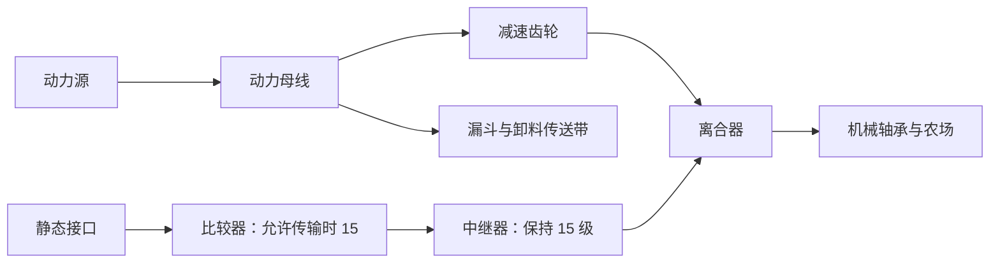
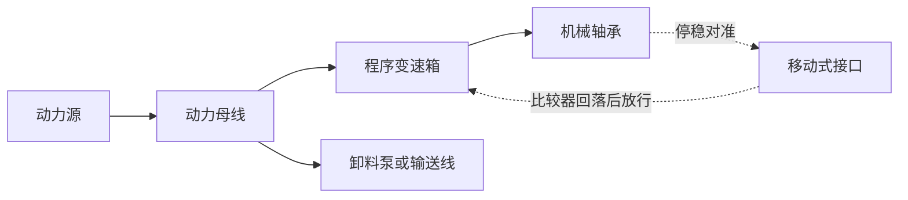
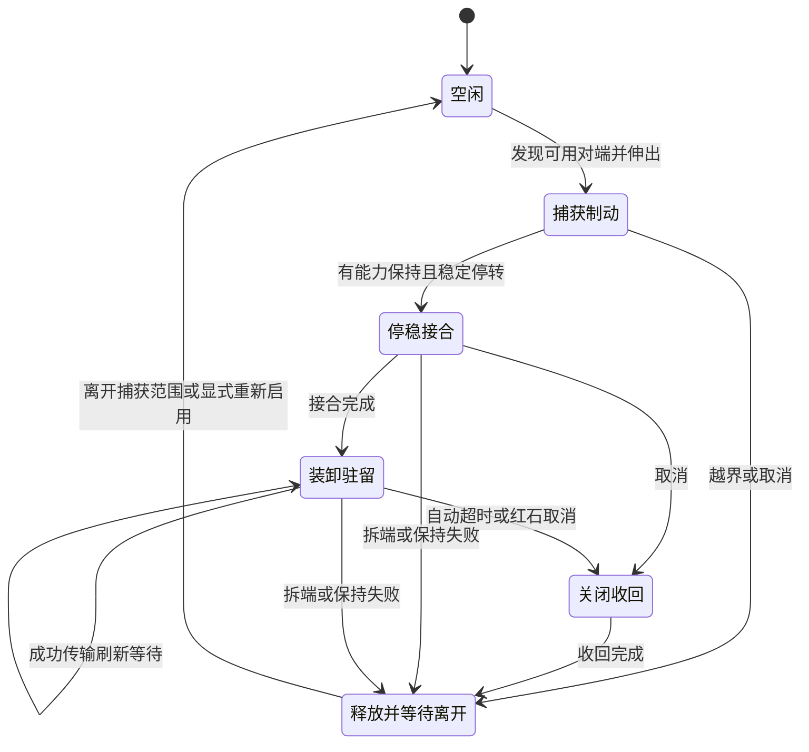

# 微分动力移动式存储接口行为设计

移动式存储接口和移动式流体接口采用同一套停靠机制。低速机器可由接口直接捕获；高速或精确机器由轨道、传动控制承担主要减速与定位，接口在可预览的对接区域内消耗剩余动能、保持结构并开放库存。装卸空闲超时或收到红石禁用后，接头关闭并收回；比较器回落表示库存关闭，需要完全脱接后再起步的回路另加收回延时。

基础低速机器通过一个离合器和接口的允许传输信号，在库存开放后隔离结构驱动；接口承担这类机器的进站制动。较高速或重载机器再通过进站档位、制动区长度、定位指令和装卸放行条件设计循环。接头仍有有限制动力与保持能力，持续强驱动或过大的剩余动能可以使停靠失败；这些限制须有可见的状态和明确的调整办法。

本文记录已经落地的公共停靠规则，以及仍需扩展的验收目标。公共制动、区域预览、连接许可比较器、物品与流体会话保护已实现，列车也已通过 `TrainActorMotion` 接入；上手与扩展入口见[接口使用指南](PORTABLE_STORAGE.md)。改造前的 74 项研究测试见[原生接口研究](PORTABLE_STORAGE_INTERFACES.md)，其中的原生暂停、速度恢复和旧能力缺陷不作为本版行为。稳定子结构、双底车、多接头、特殊控制器、高速弯轨列车及多人客户端仍需扩大验收。

## 玩家操作与结果

- 继续使用原来的两种接口、相对朝向、一格或两格空隙，以及车载合并库存。物品和流体分别对接，静态端仍须放在世界中。原生布局判定见 [Create 接口运动行为](https://github.com/Creators-of-Create/Create/blob/mc1.21.1-6.0.10/src/main/java/com/simibubi/create/content/contraptions/actors/psi/PortableStorageInterfaceMovement.java)。
- 基础低速运输可以自动停靠。高速或重载机器由控制铁轨、程序变速箱等先减速，接口只接住剩余运动；刹车距离超过功能区时经过站点，保留已经发生的减速。
- 驻留期间由漏斗、传送带、机械臂或管网完成搬运。接口提供库存通路；输送速度和耗功继续来自这些设备。
- 轴驱动结构停靠时，制动反力作用于真实驱动轴。结构驱动与卸料泵、输送线采用独立支路，通过离合器或程序变速箱隔离停靠负载，使装卸设备继续获得动力。离合器断开保留惰行，精确停车采用带制动和定位的控制器。
- 释放后由当时实际存在的动力重新加速。矿车出站需要有效轨道驱动、熔炉驱动、坡道或其他真实推力；轴承和活塞可以由动力轴继续驱动。

库存物品和流体仍遵循目前的[方块质量标定](CONTRAPTIONS.md#质量与惯量)，不在接口改造中另加内容物质量。

## 玩家搭建流程

以下是首版需要支持的四座样机。现有轨道、离合器和程序变速箱负责动力控制，接口提供连接许可比较器输出、红石禁用和有限捕获。低速入门样机使用实际比较器、导线、中继器与离合器回路；程序和矿车样机的流程记忆由测试控制器发送真实红石信号验证，完整玩家红石电路还需手工验收。

### 入门搭法：低速旋转农场

先搭半径约两三米的小型收割臂，结构支路从约 4 RPM 开始调试。旋转臂上粘合收割机、储物箱和朝向站点的移动接口；固定端与它在一次转动中的合法对准姿态相对，留一格空隙。动力母线分成两支：



静态端不设额外选项；比较器在允许传输时输出 15，其余时间为 0，输出经中继器送到离合器。静态接口本身保持允许停靠，不把这个反馈线接回它的禁用输入。离合器位于轴承支路上，卸料传送带在它之前分支取力。

| 过程 | 比较器输出 | 离合器与结构 |
| --- | ---: | --- |
| 农场转动、接口提前准备伸出 | 0 | 接合，继续驱动结构进站 |
| 两个接头实际搭接，开始制动 | 0 | 仍接合，接口消耗剩余动能 |
| 停稳并装卸 | 15 | 断开结构驱动，母线与卸料支路继续运行 |
| 空闲超时，库存关闭并开始收回 | 0 | 重新接合，结构可随动力起步 |
| 收回动画结束、完全释放 | 0 | 保持接合，等待离开标记解除后进入下一圈 |

这座机器不需要玩家设刹车时刻、停车角度或编写循环程序。正常释放后的“等待离开”标记防止接头在原地反复捕获；下一圈经过时重新允许停靠。自动放行表示一段时间没有成功搬运，并不承诺箱子已经卸空。默认比较器只在允许传输时输出 15，因此不能在制动阶段提前断开结构驱动；需要按流程断开时，应由外部程序或独立检测控制离合器。接口没有按数量保持停靠的选项；严格的装卸数量条件应由外部物流检测直接控制结构支路。

首版小型样机采用半径两米、创造马达设定 4 RPM 的起始参数，当前空载实际约 8 RPM。放大结构或提高工作速度后，可继续降速，或改用下一种精确搭法。接口捕获失败时保留真实运动，占用解除后离合器重新接合；不会免费吸附回站。

### 精确搭法：每圈回到同一位置的旋转农场

初始组装姿态就选为卸料姿态，把固定接口按这一姿态摆好。程序变速箱输出到轴承之间保持 1:1 传动；需要降低进给速度时，减速齿轮放在程序变速箱之前。动力母线独立供应装卸设备：



程序设置如下，开始按钮或脉冲发生器接程序变速箱的红石输入：

| 步骤 | 指令 | 行为 |
| --- | --- | --- |
| 1 | 正向转动 360° | 工作一圈，程序变速箱按实际负载减速并回到卸料姿态 |
| 2 | 等待红石脉冲 | 输出轴有限制动并保持，接口可以接合和装卸 |
| 3 | 结束 | 等待下一次独立启动脉冲 |

程序变速箱比较器在执行步骤 1、2 时分别输出 1、2；空闲且输入已撤去后输出 0。这个三步程序可用“至少 2 级”的比较器阈值取出等待状态，工作和空闲时给静态接口红石高电平，等待时撤去禁用。到位后解除禁用也能触发零速对端发现，沿用[原生重新发现入口](https://github.com/Creators-of-Create/Create/blob/mc1.21.1-6.0.10/src/main/java/com/simibubi/create/content/contraptions/actors/psi/PortableStorageInterfaceBlockEntity.java)。不要在转动步骤就开放接口，以免接头提前制动而阻止程序到位。

接口比较器只有允许传输时的 15。一个 RS 锁存器记录“本轮在等待步骤中出现过 15 级”；之后比较器回到 0，才产生本轮完成脉冲。这个记忆避免刚进入等待、尚未连接的 0 级立即放行；离开等待步骤时清除记忆。

完成脉冲分两路：第一路送程序变速箱，让等待步骤结束；第二路延迟后再送同一输入，启动下一圈。两次均为短脉冲，中间必须恢复低电平。首轮以 2 游戏 tick 宽度、第二路延迟 8 游戏 tick 为接线起点，实际采用脉冲中继器和中继器；第二路还须由自动运行开关允许，并确认变速箱已经空闲。等待结束不是程序自动循环，不能只接一个持续高电平。[原生输入采用上升沿](https://github.com/Creators-of-Create/Create/blob/mc1.21.1-6.0.10/src/main/java/com/simibubi/create/content/kinetics/transmission/sequencer/SequencedGearshiftBlockEntity.java)，当前适配同样保留这一约定。

默认连接许可在允许库存访问时为 15，其余时间为 0；其下降表示库存关闭并开始收回，此时接头可能仍在收回。需要等接头完全离开后再起步时，在完成脉冲前加入覆盖收回动画的延时。

这座机器由玩家指定“在哪停、做几圈再卸料”，减速时机由现有[程序变速箱控制器](../src/main/java/com/diliupengyun/differential_create/kinetics/SequencerMotion.java)根据实际惯量和制动能力安排。玩家无需手动切换刹车；过重或外部持续驱动超过控制能力时，才调整传动和工作档位。

### 矿车自动卸货站

直线站点的基本布置为：

```text
行驶方向 →
巡航轨道 ─ 低速控制铁轨区 ─ 通电动力铁轨 ─ 定位控制铁轨 ─ 通电出站轨 ─ 检测轨
                1 级          独立供电        0 / 15 级
```

按矿车停在定位轨中心时移动接口的实际高度和朝向摆放固定端，沿轨道侧面对接，双方留一格空隙。低速区和定位轨之间用一格独立供电的动力铁轨隔开，出站轨也独立供电，检测轨放在定位轨之后足够远的位置。

低速区先采用 1 级信号；当前标准 0.4 m/tick 轨道上对应约 0.0267 m/tick 的目标速度，实际仍由有限推力与载荷决定。定位轨在等待到站和装卸时保持 0 级，由当前[控制铁轨适配](../src/main/java/com/diliupengyun/differential_create/mixin/MinecartControllerRailMixin.java)有限驱动矿车向轨中心归位。首轮从数格低速区开始实测，重车制动来不及时延长低速区，不能保证固定一格轨道停住所有载荷。

控制铁轨会从相连的同向控制铁轨推算信号，所以不同档位区间用其他种类轨道分隔，并检查定位轨实际读数确实为 0，避免相邻低速区给停车点带入非零目标。[原生控制铁轨](https://github.com/Creators-of-Create/Create/blob/mc1.21.1-6.0.10/src/main/java/com/simibubi/create/content/redstone/rail/ControllerRailBlock.java) 过渡段保留有效推进，避免极低速轻车在普通轨上惰行不足一格而提前停下；进入定位轨后的动能仍由有限控制力与接口反力消耗。

红石回路用两个记忆状态完成一个车次：

| 条件 | 回路动作 |
| --- | --- |
| 默认或上一车已离开 | 到站记忆清除，定位轨保持 0 级 |
| 比较器出现 15 | 记住本车已经连接，库存已开放 |
| 本车连接过，比较器回到 0 | 库存关闭并开始收回；延时覆盖收回动画后锁存出站命令，定位轨切换到 15 级 |
| 本车通过出口检测轨并离开它 | 清除本车记忆和出站命令，定位轨回到 0 级 |

用出口检测轨的离开事件复位，避免车刚碰到检测轨就撤去推进、重新把仍在停车轨上的车刹住。上面的出站命令由实际轨道有限加速，没有写回进站速度。入口需要另设车间隔或信号控制，入门站一次只服务一座矿车结构。

### 活塞往返平台

选择至少 8 格有效行程的活塞机构，先把平台停在伸出 2 格的位置。两个装卸点设在伸出 2 格和 6 格处，都在有效行程内部；不要把完全缩回的位置作为停靠点，以免按原生流程拆解结构。初次归位使用单独的定位程序，再从这个起点开始循环。

| 步骤 | 指令 | 停靠控制 |
| --- | --- | --- |
| 1 | 正向移动 4 格 | 两个接口禁用 |
| 2 | 等待红石脉冲 | 只启用伸出 6 格处的接口 |
| 3 | 反向移动 4 格 | 两个接口禁用 |
| 4 | 等待红石脉冲 | 只启用伸出 2 格处的接口 |
| 5 | 结束 | 另一个启动脉冲开始下一轮 |

每个等待步骤分别记录本次连接，比较器输出回落后再发继续脉冲；若必须等完全释放，用延时覆盖收回动画。步骤 2 的脉冲直接进入反向行程；步骤 4 的脉冲先结束程序，再由延迟的独立脉冲重新启动。比较器步骤 2、4 的阈值须分别解码，不能把“至少 2 级”当作两个站通用的等待信号。活塞轴直接由程序变速箱以 1:1 传动驱动，卸料泵和传送带仍从变速箱之前的母线取力。角度、距离与等待的当前能力见[程序变速箱设计](../DESIGN.md#61-可编程齿轮箱)。

## 玩家可观察和调整的规则

扳手预览显示对接中心、准备区和功能接触区。接触区采用方块尺度的固定规则，首轮横向位置容差取各方向正负 0.5 格，轴向沿用一格或两格空隙的伸缩布局，方位容差沿用原生判定。横向范围以双方功能接触中心在静态接口面内的投影差定义，完整横向区间为一格；沿任意运动路线的实际可用路程仍由该路线与功能区的交集决定。

伸出准备可在预计经过功能区前启动，预告只用于动画与准备，不提供提前反力。低速进站或先定位停车时，应留够接头伸出时间。渲染模型表现接触过程，模型中几像素的尺寸变化不改变捕获规则；接口接触能力是明确标定的机械抽象。

移动式接口不额外添加护目镜信息。玩家通过接头伸缩动画、比较器反馈和扳手范围预览观察停靠行为；调整顺序为检查停车位置、降进站档位、增加减速区或隔离驱动。

接口不提供额外的扳手选项。固定端比较器在允许库存访问时为 15，空闲、准备、制动、接合和收回期间均为 0。这个读数直接服务物流许可和离合器反馈；它不表示接头已经完全脱接，信号下降时收回动画才刚开始。

靠近站点时比较器保持 0，离合器仍接合，接口按有限能力制动并保持。停稳接合、库存开放后输出 15；若用它断开结构支路，此时结构已经停住。自动空闲超时或红石禁用会关闭库存，比较器随即回到 0，结构支路可以重新接合。需要等完全释放后再出站时，用外部延时覆盖收回动画。

红石高电平始终表示禁用：立即关闭访问、开始收回并禁止新捕获。接口没有持续等待红石才放行的模式，也没有机械占用或阶段读数；慢速灌装通过每次实际非零传输续期自动超时，需要按数量结束时由外部物流检测控制结构支路。

离合器的红石响应是模拟量，15 级才完全分离；长红石线末端加中继器恢复到 15，避免只降低咬合度而仍传入持续驱动。[当前离合器控制](../src/main/java/com/diliupengyun/differential_create/kinetics/ClutchControl.java)

## 状态与访问时序

| 状态 | 机械行为 | 库存访问 | 退出条件 |
| --- | --- | --- | --- |
| 捕获制动 | 先伸出接头；实际搭接后施加有限反力，保留实际位移 | 关闭 | 接触后停稳，或离开范围、取消、失去对端 |
| 停稳接合 | 用有限静摩擦保持实际停止姿态，确认并锁紧接头 | 关闭 | 接合完成，或保持失败、取消 |
| 装卸驻留 | 继续保持，搬运由外部设备进行 | 开放 | 自动空闲超时、红石取消或连接失效 |
| 关闭收回 | 先使会话失效，再收回接头；正常收回期间继续保持 | 关闭 | 收回完成；拆端等情况立即释放 |
| 释放 | 撤去接头反力，沿真实运动状态继续积分 | 关闭 | 离开此次捕获范围后，允许同一对接口再次停靠 |

空闲时不施加接头反力。一次经过可以先制动失败，随后离开；失败不会开放库存，也不会把结构拉回站点。



进入驻留以接受后的物理状态为准：两端已经实际接触，驱动自由度已在制动能力内停转，对接位姿稳定至少一个游戏 tick，再锁紧并开放库存。判定不通过赋值速度或吸附位置完成。接头伸出和正常收回各暂取原生 `ANIMATION` 的 4 tick；这些阶段及制动过程不占用装卸等待时间。

接头的伸缩适应实际停止位置，结构保留该位置和角度。若实际姿态不在对接几何范围内，即使已经减速为零，也不接合。

## 捕获与有限制动

对端发现沿用原生类型、方位和伸缩范围判定，并扩展为沿真实运动轨迹检查。平移检查线段，旋转检查圆弧，矿车的平移、偏航和俯仰使用与连续工具相同的接受轨迹。方位合法性也沿轨迹检查，高速结构不能只查 tick 两端。

零速结构也可发现新放置的可用对端并原地接合。查询限于轨迹附近已经加载的站点，只有含接口的结构启用捕获计算。

发现沿途符合类型、朝向、红石和预约条件的对端后可提前准备伸出接头，这个阶段没有制动力。伸出沿用原生接头功能，内部动作能耗暂不模拟。准备预测不保证将来接触，实际搭接仍按接受后的轨迹确认。伸出准备若来不及完成，结构可以直接经过站点；不能补算接触前的制动功。

机械捕获采用可预览的功能搭接区。双方伸出头到达可接触的轴向位置、功能接触区重叠且方位仍合法时，才建立摩擦接触并开始制动。一格或两格空隙规定轴向伸缩布局，不规定沿行进方向的刹车行程；捕获测试以已显示的功能区和真实轨迹求取有效接触区间，不使用渲染网格的隐藏尺寸。

两端实际搭接的第一个事件开始施力，伸出进度和结构位姿共同决定这个事件。接头在未搭接时不提前施力，不改变动力源目标速度。之后在停转、搭接失效、朝向失效及其他作业事件处分段；停止位置取真实积分结果。制动不足时允许穿过接触范围，离开瞬间撤去接头反力。停稳后只在原地锁紧，不靠夹具倒拉回名义站点。

接头与世界之间采用被动摩擦制动：运动时反力与相对运动相反；停转时在额定上限内抵消外力。静摩擦保持位置时机械功为零。反力不足以维持停止时发生滑移，立即关闭会话并松脱。接口过载采用松脱行为，现有轴系连接仍按自己的强度规则判定断裂。

每对接口具有一个平移反力上限和一个接头扭转力矩上限。后者使轴线上安装的接口也能制动结构自转。稳定子结构自身不自转时只计其安装点运动的反力，沿主结构驱动路径传回；每个接头只计一次。

### 初始标定与功的折算

首轮标定采用普通离合器的 `1024 su/RPM` 作为参考值。它是玩法起点，需通过停车距离和持续推力测试调整，不代表材料参数。

设驱动坐标 `q = ∫ω dt`，时间单位为 min，沿用[现有单位体系](../DESIGN.md#1-单位体系)。平移控制器每个参考转动坐标对应的行程为 `L₀ = 1200/512 = 2.34375` 米。接头的平移制动功按实际接触位移计，参考系数为：

```text
B = 1024 / L₀ ≈ 436.9067 (su/RPM)/m
M = 1024 su/RPM

g = |dp/dq|                  接头世界位置对驱动坐标的变化率
h = |接头角速度/驱动角速度|  接头姿态的真实转动倍率
T_limit = B·g + M·h
```

在当前单个相关驱动自由度上，运动摩擦为 `−T_limit·sign(ω)`；静止时反力在这个范围内解出。制动耗散由同一物理子步核对：

```text
W_dock = ∫T_limit·|ω|dt = B·接头实际平移路程 + M·接头实际转动行程
```

平移和扭转是两项独立标定的被动接触能力。半径和传动倍率进入真实几何导数，不能沿用切削工具的虚拟刀具半径，也不能对任何结构都直接施加固定输入轴扭矩。简单轴承半径为 `r`、倍率为 `k` 时，`g=2πr|k|`、`h=|k|`；纯平移倍率为 `k` 时，`g=L₀|k|`、`h=0`。

`g` 和 `h` 从运动几何求出，零速时也有效，不能通过两个实时速度相除得到。停稳判定暂取接头速度不超过 0.001 m/tick、相关驱动速度不超过 0.05 RPM，姿态一 tick 内漂移不超过 0.002 米和 0.02°，并确认静摩擦有能力维持停转。阈值用于确认和显示；剩余动能仍须经接受的制动积分耗散，不能在阈值处直接删掉。

以下仅用于检查尺度，假设直线矿车存储速度等于实际轨道速度，进站速度为 0.4 m/tick，只有一个接口，没有持续推进和其他阻力。参考制动力矩为 1024，沿用[矿车惯量](MINECARTS.md#装配质量与阻力)：

| 载荷 | 等效惯量 | 理想停止时间 | 理想停止距离 |
| --- | ---: | ---: | ---: |
| 空底车 | 0.01 | 2.4 tick | 0.48 米 |
| 100 个结构方块 | 约 0.01835 | 4.40 tick | 0.88 米 |
| 1000 个结构方块 | 约 0.09349 | 22.44 tick | 4.49 米 |

实际捕获范围、轨道限速、空气阻力和驱动会改变结果。这组数值只给出停止所需路程，须与接头伸出完成后还剩的实际搭接行程比较，不能据此保证轻车必能被接口接住。重车和高速车需要提前减速。制动力不按载荷同步增大，也不使用固定“几 tick 必停”的控制。

例如上述空车需要 0.48 米停止距离；从功能区边缘进入、伸出已经准备完成且有一米横向行程时，具备足够的理想停车距离。若由于伸出延迟或斜向经过，只剩 0.30 米有效行程，则离开接触时仍约有 0.245 m/tick 的速度，停靠失败。玩家可以从功能区预览、进站速度和就绪状态判断该调整哪项，而无需反推模型像素。

## 不同驱动的受力与释放

### 矿车

制动从当前底车与装配体的动能中扣除。接触位移使用实际轨道位移；原生存储运动向量大于轨道位移上限时，复用连续工具的速度比折算，不能把实际短行程当作更长的制动做功。

驻留时动力轨、控制轨、熔炉、坡道及联结的有效外力仍参与保持能力判断。受控运动保持在零速并不等于无限抵抗邻车；外力超过接头上限时松脱。联结及原生硬位置校正若使对接位姿失效，也必须先关闭库存访问。

双底车支撑同一装配体时按一个停靠结构处理：两底车及各自结构份额只计一次，沿各自轨道切向分配反力，共享一次接头制动功。一个接口不能向每辆支撑车各赠送一份完整制动力；联结的其他装配体通过原有联结传递反力。此场景须专项验证，不能只复用单车的速度归零。

释放保留停止后的真实速度，保存的进站方向只用来确定出站意图。首次释放时向当前有效轨道驱动发出一次起步请求：通电动力轨按原有 0.02 低速起步标定和现有力矩、功率预算提供推力，控制轨和熔炉使用各自现有驱动。没有有效驱动时保持静止；接口不承担起步功，也不写回进站速度。这条有限起步路径已接入当前矿车适配。

### 轴承和直线结构

接头制动反力折算到实际承载结构的驱动节点，结构惯量始终附着于该节点。普通轴承、活塞、滑轮和龙门架在停靠期间保持既有机械耦合，上游通过真实弹性连接感受到反力，可能减速或停转。停靠不自动增加内部离合器。

零速驻留时结构空气阻力和进给工具的作业功均为零。上游其他节点仍可有真实转速、弹性形变或离合器滑移；求解器继续推进整个网络。禁止只冻结模型角度却让承载同一结构惯量的节点继续正常旋转，也禁止把整个网络的速度直接赋零。

释放只撤去接头负载，从保存的真实速度、角度和弹性状态继续积分。上游弹性势能可以推动结构重新运动，其能量来自此前真实驱动做功。所有输出位移仍只消费一次，驻留期间没有积攒的结构行程需要补播。

其他驻留 actor 若暂时使模型输出与作业输入脱耦，需要先确认接头所约束的真实承载自由度。原生 `stall` 本身不代表已经物理停稳；混合场景必须验证反力路径、作业供能和各暂停原因的独立释放。

稳定子结构对接时，反力沿其所属主结构驱动传递；原生保持朝向不会让整个主结构免于承担这份负载。钟表轴承、升降机及多输出控制器还需要核对独立到站流程和运动倍率后接入同一规则。

## 装卸等待与信号

自动放行下，首次开放库存时给予完整的 `psiTimeout` 等待时间，默认沿用 60 tick；每次成功执行非空物品或非零流体传输再刷新为同一配置值。原生配置与传输续期入口见 [Create 接口计时](https://github.com/Creators-of-Create/Create/blob/mc1.21.1-6.0.10/src/main/java/com/simibubi/create/content/contraptions/actors/psi/PortableStorageInterfaceBlockEntity.java)。红石高电平立即取消驻留，不因空闲超时另作等待，仍检查存活、几何和保持能力。

这会改变原生首次连接固定 14 tick、动画与等待共用倒计时的行为。新计时从可传输时开始，刹车和伸出不消耗首次装卸机会。查询、模拟、失败传输、满库存或空库存均不续期；持续实际搬运可以一直驻留。达到空闲超时即进入关闭收回，不以“库存搬空”作为结束条件。

自动放行的等待截止也是每次库存调用的权限条件。已经到期的调用不能再续期，不得因静态方块实体的 tick 顺序较晚而多获得一个传输窗口。

不足 1 mB 的受液缓冲尚未发生原生库存提交，不续期，也不强行取整成 1 mB。自动放行时，极低流量的整数交付间隔长于配置等待可以超时；需要慢流的流程应让外部设备保持实际非零交付，或由外部检测控制结构启停。模拟传输不能延长访问权限。

连接许可为 0 或 15，15 表示当前确实允许库存访问；制动、伸出、接合、收回和失效均为 0。信号只服务访问许可，不划分准备、制动和收回阶段。红石上升立即禁止访问并进入正常关闭收回；信号保持期间拒绝新捕获。关闭移动端 actor 使用相同取消规则。

拆掉任一端、实体消失、几何失效或保持滑移时，会话立即失效并撤去已不存在的机械接触。动画不延长权限或产生幽灵制动力。正常超时收回完成后释放；收回期间保持失败同样立即释放。

所有计时按游戏 tick 推进一次，数值积分子步不重复计时，整个世界冻结不推进等待或伸缩动画。

## 库存会话与流体守恒

每次成功接合创建独立会话，绑定静态端位置、移动端局部位置、结构 UUID 和递增的会话代号。静态端每次只归属于一个移动端；同一结构可以有多个物品或流体接头分别对接不同的静态端。

首版每次访问直接核对固定端当前方块实体身份、结构存活与身份、actor 启用状态和当前几何；卸载回调主动撤销会话。额外的两 tick 更新租约属于后续异常生命周期防护，尚未加入。空闲等待与伸缩计时在整个世界冻结时暂停。

handler 的每次查询、模拟和执行均检查自己的会话仍有效、双方存活且已加载、几何有效、红石未禁用，以及状态确实处于装卸驻留。开放、关闭、更换对端和重新接合均发送 capability 失效通知。过期 handler 返回空或拒绝操作；它不得操作旧车库存，也不得自动转向新车库存。

仅把流体 `fill()` 改为当前接口的 `canTransfer()` 能修复已复现的红石断开边界，但重新接合另一辆车后，还须用会话代号拒绝旧 handler。所有物品插取与两种流体抽取也使用同一权限门槛。原生检查差异见 [Create 流体 handler](https://github.com/Creators-of-Create/Create/blob/mc1.21.1-6.0.10/src/main/java/com/simibubi/create/content/contraptions/actors/psi/PortableFluidInterfaceBlockEntity.java)。

权限关闭先于机械释放和下一个传输调用。一次库存执行在服务器线程完成；已完成的搬运有效，关闭后新的调用立即被拒绝。动画倒计时和比较器不单独授予访问权限。

连续流体仍以整数 mB 对接原生车载库存。关闭时取消旧会话的库存容量预留，已经抽出的流体和待注入的小数保留在外部管网自己的容量缓冲中。重新接合后重新查询接受能力，缓冲流体可以像普通管内存液一样送给新对端；旧库存预留和旧 handler 不能延续。不得为清理会话删除流体、重新生成流体或给新车沿用旧车容量预算。

多个接口指向同一车载合并库存时，供液与受液预算按真实库存身份共享；访问许可仍按各自会话分别检查。不能因为 handler 包装对象不同，就把同一份库存和容量重复分配。

接口采用[统一的库存边界](FLUIDS.md)，不从车载储罐液位推算额外压力；泵压、阻力与泵耗功沿用连续流体求解器。液压力对载具的反作用和内容物质量属于后续流体与结构耦合范围。

## 多接头与再次停靠

一个静态接口由先处理的接受后姿态取得预约，候选站点按坐标排序。失败、取消或释放时解除预约，不允许多个移动结构通过同一个静态端共享库存。跨结构同时到达的完整身份排序仍需补充验收。

同一结构多个有效夹点的反力可叠加，每个夹点各有额定上限和自动等待计时。一个接头结束不会强制松开仍在装卸的另一个；总保持能力下降后若发生滑移，所有已经失去几何稳定性的会话同时关闭。新夹点只能在真实当前姿态下接合，不能拉扯结构以强行满足互相冲突的位置。

正常超时释放和捕获失败后，对本次接口对保留“等待离开”的标记，防止结构刚放行就被同一接头重新捕获。当前必须完全离开准备区并越过退出余量，才允许下一次自动捕获；只离开功能接触区不会重置标记。准备区本身不施加制动。固定端红石由高变低会清除附近对应接口的重捕获限制，可以在原地重新预约，随后仍须重新停稳和接合。

## 保存与加载

保存真实结构姿态、相关转速、停靠阶段、剩余等待、出站方向、目标对端和等待离开标记。会话权限不从 NBT 的旧计时器直接恢复：加载时重新准备接头，确认同世界身份、几何与稳定停车，才创建新的有效代号。重新查询权限不重置剩余空闲等待；动画重新经历首版的四 tick 准备或收回过程，不恢复旧库存权限。

实体或静态端卸载立即使内存中的会话和 handler 失效，不主动加载区块。两端均卸载后从各自持久化状态重建；单端不在场时不给库存访问或幽灵约束。释放或继续停靠所需的物理状态保持原值，不恢复历史进站速度。

卸载先快照机械阶段，再使运行时会话失效。重新加载后若结构仍在原对接范围内，可按保存的剩余等待重建停靠；若期间已经移动离开，则放弃旧停靠记录，按实际位置重新发现站点。

不迁移旧测试存档的原生接口驻留记录；新建停靠不保存或恢复进站速度。其他 actor 的原生暂停保持其独立规则，公共接口在遇到这类暂停时关闭会话，不将其当作物理停车确认。

## 实现顺序与验收

当前已接入功能区、控制信号、统一会话保护、首次完整等待、关闭时序、真实管网和公共驱动的有限制动。列车质量与驱动已适配，接口制动从整列等效动能中扣除，路径导航和站点调度仍使用原生流程；直轨场景由 [TrainOperationTests](../src/gameTest/java/com/diliupengyun/differential_create/tests/TrainOperationTests.java) 验证。稳定子结构、双底车、多个夹点、特殊控制器与高速弯轨仍需扩大验收，下表是完整目标范围，不表示每行都已通过。

基础验收先跑上述四座完整样机：低速离合器农场、程序变速箱旋转农场、矿车自动卸货站和活塞往返运输平台。每座至少连续完成 100 次到站、装卸和离站；使用小型和大型结构、低速及高速工作档，按预览提示调整进站控制后均能重复运行。低速离合器农场单独验证少量元件即可运行，并测试红石传播延迟、捕获失败后重新驱动和准备阶段不提前断开。控制使用真实轨道、程序步骤和红石回路，不由测试手动调用对接回调、赋值速度或指定终点姿态。旋转农场须确认结构停住时卸料泵和输送线仍正常供能。自动空闲放行和红石禁用分别验证，不把以下局部物理测试通过等同于样机可用。

| 验收场景 | 必须满足的结果 |
| --- | --- |
| 轻车与重车同速进站 | 重车停止距离更长；越界失败无吸附或免费停车 |
| 持续驱动与驻留 | 保持能力内停转；超过能力松脱，传输立即关闭 |
| 无外部驱动的矿车释放 | 保持零速，进站速度不恢复 |
| 通电动力轨、控制轨与熔炉出站 | 有限加速，新增动能可追溯到有效驱动预算 |
| 轴承或活塞停靠 | 承载节点真实减速、反力传回轴系；惯量不丢失 |
| 上游飞轮及离合器 | 保存真实弹性和转速；释放只使用真实存量能量 |
| 轴线上接口、长臂及稳定吊舱 | 力臂、自转与稳定子结构折算各计一次 |
| 高速跨格、跨方位和 tick 内反转 | 发现中途接触与离开，状态只由接受后的轨迹改变 |
| 发现对端、伸出延迟和接触行程 | 未搭接不施力；伸出太晚或滑移行程不足可以失败 |
| 连续工具和原生驻留 actor 混用 | 接头反力与作业供能一致，不因其他 `stall` 免费停靠或误清暂停 |
| 空闲、模拟、失败与持续搬运 | 首次完整等待；只有真实非零传输续期 |
| 低流量与多管口共享库存 | 整数提交不制造流量；关闭保留外部存液和小数 |
| 红石禁用和延迟供液 | 高电平立即关闭并收回；持续实际交付可延长自动等待 |
| 红石、拆端、失活和旧 handler | 状态关闭后拒绝全部读写；重新接合不复活旧对象 |
| 双底车、联结和多个夹点 | 惯量、反力、库存和制动功不重复；减少夹点后重新验算保持 |
| 冻结、单端卸载和双端读档 | 不推进冻结时间、不幽灵传输、不恢复旧进站动能 |
| 比较器和客户端伸缩 | 15 与真实传输许可一致，其余阶段为 0；播放服务器接受后的停靠阶段 |
| 停车点、程序到位和供能分支 | 位置可按标准布局重复搭建；停靠不抢占指令到位；卸料支路持续供能 |

物理回归核对驱动做功、动能与弹性储能变化、现有损耗和接头耗散的平衡。库存回归核对双方库存与外部缓冲总量。当前 [PortableDockingTests](../src/gameTest/java/com/diliupengyun/differential_create/tests/PortableDockingTests.java) 已检查断开或换车后旧 handler 拒绝访问；历史研究工具保留缺陷复现判据，仅用于研究版本，不能直接充当当前方案验收。

主要维护入口是 [ContraptionMotion](../src/main/java/com/diliupengyun/differential_create/kinetics/ContraptionMotion.java)、[ContraptionPhysics](../src/main/java/com/diliupengyun/differential_create/kinetics/ContraptionPhysics.java)、[ElasticKinetics](../src/main/java/com/diliupengyun/differential_create/kinetics/ElasticKinetics.java)、[MinecartActorMotion](../src/main/java/com/diliupengyun/differential_create/kinetics/MinecartActorMotion.java)、[MinecartPhysics](../src/main/java/com/diliupengyun/differential_create/kinetics/MinecartPhysics.java) 和 [FluidKinetics](../src/main/java/com/diliupengyun/differential_create/kinetics/FluidKinetics.java)。新停靠状态独立于切削任务，物理试算不得预约站点、改库存或发布 capability；接触提交后才执行这些世界操作。
